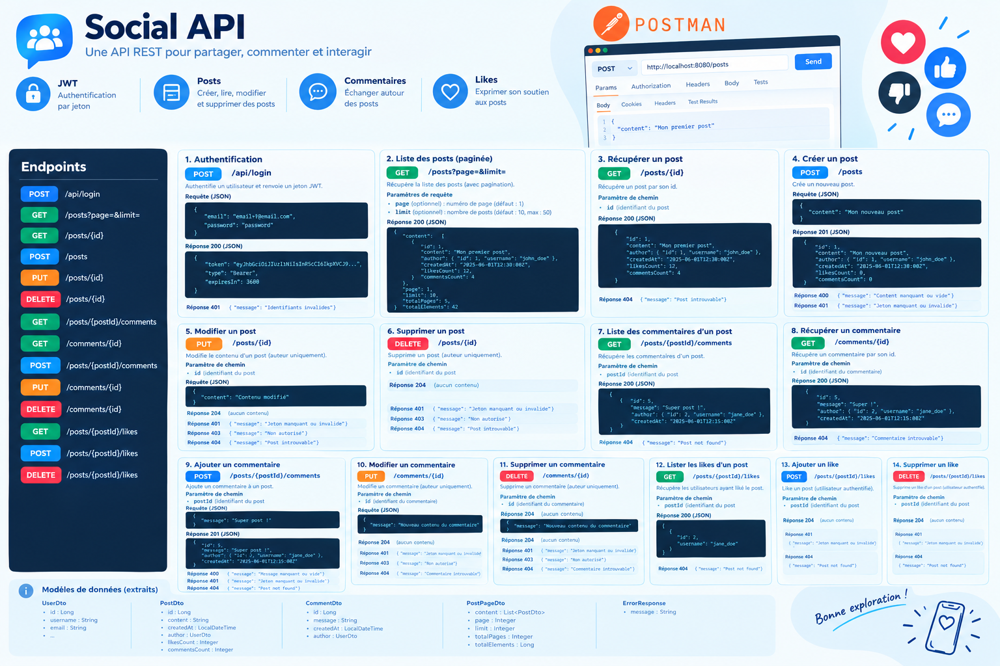

# Social API


API REST de réseau social — publication, commentaire, liker avec authentification JWT.
Version Java de mon [API REST](https://github.com/habibahdev/social-api) développée avec Symfony 7 / PHP 8.




*Image générée par IA.*

---

## Démarrer

```bash
docker compose up --build
```

 - Application disponible sur `http://localhost:8081`

---

# Documentation

La documentation est disponible [ici](docs/index.md).

---

# Évolutions possibles

- Ajouter une route POST /api/register pour créer des comptes sans dépendre du DataSeeder.
- Ajouter un mécanisme de rafraîchissement du token, au lieu d'avoir une durée fixe.
- Pagination des routes GET /posts/{postId}/comments et GET /posts/{postsId}/likes
- Faire une migration de schéma, en remplaçant Hibernate (spring.jpa.hibernate.ddl-auto=update) par Flyway ou LiquiBase
